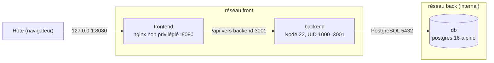

# Conduit : conteneurisation et durcissement Docker

Conteneurisation sécurisée d'une application web trois tiers (React/Vite, Express/Sequelize, PostgreSQL) : images **naïves** et **durcies** auditées, deux piles Docker Compose (naïve et durcie) et une batterie de tests automatisée qui mesure l'écart avant/après.

> **Périmètre.** Ce dépôt ne porte que sur la conteneurisation et la sécurité. Le code source de l'application n'est pas modifié ; seules des versions de dépendances ont été relevées dans le lockfile pour corriger des CVE (`proxy-addr`, `path-to-regexp`, `lodash`). Toute la configuration passe par les Dockerfiles, les fichiers Compose et des variables d'environnement.

## Sommaire

1. [Résultats en un coup d'œil](#1-résultats-en-un-coup-dœil)
2. [Architecture](#2-architecture)
3. [Structure du dépôt](#3-structure-du-dépôt)
4. [Prérequis](#4-prérequis)
5. [Démarrage rapide](#5-démarrage-rapide)
6. [Les images Docker](#6-les-images-docker)
7. [Audit des images](#7-audit-des-images)
8. [Orchestration : pile naïve et pile durcie](#8-orchestration--pile-naïve-et-pile-durcie)
9. [Tests automatisés](#9-tests-automatisés)
10. [Limites et constats](#10-limites-et-constats)
11. [Dépannage](#11-dépannage)
12. [Crédits et licence](#12-crédits-et-licence)

---

## 1. Résultats en un coup d'œil

### Images

| Critère | Naïve (frontend et backend) | Frontend durci | Backend durci |
|---|---|---|---|
| Vulnérabilités Trivy | 4 199 | **0** | 234 |
| dont CRITICAL / HIGH | 21 / 379 | 0 / 0 | 1 / 48 |
| Paquets (SBOM) | 911 | 22 | 208 |
| Utilisateur | root | 101 | 1000 |
| Taille sur disque | 2,12 Go | 98,9 Mo | 378 Mo |
| Hadolint | 2 alertes | 0 | 0 |
| Règles Conftest (SBOM) | 10 échecs (frontend), 9 (backend) | 5/5 | 4/4 |

### Piles Compose

| | Pile naïve | Pile durcie |
|---|---|---|
| Tests fonctionnels (F1 à F6) | 6 / 6 OK | 6 / 6 OK |
| Faiblesses exposées (S1 à S11) | **11 / 11** | **0 / 11** |

Les chiffres des images dépendent de la base de vulnérabilités Trivy utilisée (voir [section 7](#7-audit-des-images)) et les deux familles d'images ne reposent pas sur les mêmes systèmes de base (voir [section 10](#10-limites-et-constats)).

---

## 2. Architecture



Dans la pile durcie :

- seul le frontend est publié, et uniquement sur la boucle locale (`127.0.0.1:8080`) ;
- le backend et la base n'ont aucun port publié : ils ne sont joignables que par les conteneurs des réseaux Docker concernés ;
- le réseau `back` est déclaré `internal` : la base n'a ni accès sortant, ni accès depuis l'hôte ;
- le nom du service backend (`backend`) est imposé par `frontend/nginx.conf`, qui relaie `/api` vers `http://backend:3001`.

---

## 3. Structure du dépôt

```text
.
├── backend/
│   ├── Dockerfile               # image durcie (stages deps / migrate / runtime)
│   └── Dockerfile.naive         # image naïve de référence
├── frontend/
│   ├── Dockerfile               # image durcie (build Node, runtime nginx non privilégié)
│   ├── Dockerfile.naive         # image naïve de référence
│   └── nginx.conf               # reverse proxy /api vers backend:3001
├── policy/                      # règles Rego (Conftest) appliquées aux SBOM
├── scripts/                     # scans, analyses et tests (voir sections 7 et 9)
├── reports/                     # rapports générés (Trivy, SBOM, Conftest, tests Compose)
├── docs/JOURNAL.md              # journal de méthode et statistiques des tests
├── docker-compose.naive.yml     # pile naïve (référence)
├── docker-compose.hardened.yml  # pile durcie
├── .env.example                 # modèle des variables de la pile durcie
└── LICENSE                      # licence de l'application d'origine
```

---

## 4. Prérequis

- Windows avec Docker Desktop (Docker Compose v2).
- Windows PowerShell 5.1 ou PowerShell 7 (les scripts sont en ASCII pour éviter les problèmes d'encodage de 5.1).
- Ports libres sur l'hôte : `3000`, `3001`, `5432` pour la pile naïve ; `8080` pour la pile durcie.
- Accès à Docker Hub. En cas de problème DNS, l'image PostgreSQL peut être tirée depuis le miroir `public.ecr.aws/docker/library/postgres`.

---

## 5. Démarrage rapide

### 5.1 Construire les images

Depuis la racine du dépôt (le contexte de build est la racine : le projet utilise des workspaces npm).

```powershell
docker build -f backend/Dockerfile.naive  -t conduit-backend:naive  .
docker build -f frontend/Dockerfile.naive -t conduit-frontend:naive .
docker build -f backend/Dockerfile --target runtime -t conduit-backend:hardened  .
docker build -f frontend/Dockerfile -t conduit-frontend:hardened .
```

> [A COMPLETER : vérifier ces quatre commandes (chemins des Dockerfiles, `--target`, contexte) avec `git ls-files "*Dockerfile*"`.]

### 5.2 Pile naïve

```powershell
docker compose -f docker-compose.naive.yml up -d
docker compose -f docker-compose.naive.yml ps
docker compose -f docker-compose.naive.yml down
```

Frontend (serveur de développement Vite) sur `http://localhost:3000`, API sur `http://localhost:3001`, base sur `localhost:5432`.

### 5.3 Pile durcie

Créer le fichier `.env` (ignoré par git) à partir du modèle, puis remplacer les valeurs par de vrais secrets :

```powershell
Copy-Item .env.example .env
$b = New-Object byte[] 24; [Security.Cryptography.RandomNumberGenerator]::Create().GetBytes($b); ($b | ForEach-Object { $_.ToString("x2") }) -join ""
```

Lancer la commande de génération une fois pour `DB_PASSWORD` et une fois pour `JWT_KEY`, puis démarrer :

```powershell
docker compose -f docker-compose.hardened.yml config --quiet
docker compose -f docker-compose.hardened.yml up -d
docker compose -f docker-compose.hardened.yml ps
```

L'application est servie sur `http://localhost:8080`. Compter 30 à 60 secondes avant que les trois services soient `healthy`. Arrêt (les données de la base sont conservées dans un volume nommé) :

```powershell
docker compose -f docker-compose.hardened.yml down
```

Ajouter `-v` supprime aussi le volume, donc toutes les données.

> `config` sans `--quiet` afficherait les secrets en clair : ne pas le coller dans un ticket ou un message.

### 5.4 Lancer les tests

Une seule pile à la fois (voir [section 9.5](#95-règles-de-lecture)).

```powershell
docker compose -f docker-compose.naive.yml up -d
powershell -ExecutionPolicy Bypass -File .\scripts\test-compose.ps1 -Stack naive
docker compose -f docker-compose.naive.yml down

docker compose -f docker-compose.hardened.yml up -d
powershell -ExecutionPolicy Bypass -File .\scripts\test-compose.ps1 -Stack hardened
docker compose -f docker-compose.hardened.yml down

powershell -ExecutionPolicy Bypass -File .\scripts\test-compose.ps1 -Compare
```

---

## 6. Les images Docker

### 6.1 Images naïves (référence)

Dockerfiles volontairement simples : l'image embarque tout le monorepo (`COPY . .`), tourne en root, n'a pas de tags figés ni d'optimisation. Le frontend lance le serveur de développement Vite (`npm run dev -w frontend -- --host`) et le backend lance `npm start` via les workspaces. Les deux images ont les mêmes couches (2,12 Go sur disque, 16 couches) ; elles servent de ligne de base pour mesurer l'effet du durcissement.

### 6.2 Frontend durci

- Build multi-stage : Node 22.23.3 (`bookworm-slim`) pour compiler, puis `nginxinc/nginx-unprivileged:1.28-alpine` pour servir uniquement les fichiers statiques.
- Exécution sous l'utilisateur `101`, port `8080`.
- Modules nginx superflus (`geoip`, `image-filter`, `njs`, `xslt`) et `curl` retirés ; nginx mis à jour vers la version corrigée disponible.
- `HEALTHCHECK` (forme tableau) interrogeant `/healthz`.
- `nginx.conf` : reverse proxy de `/api` vers `backend:3001`.

### 6.3 Backend durci

Trois stages sur `node:22.23.3-bookworm-slim` :

| Stage | Rôle |
|---|---|
| `deps` | `npm ci --omit=dev` : dépendances de production uniquement |
| `migrate` | `npm ci` complet et `sequelize-cli db:migrate` ; **non utilisé** par les compose (voir [section 10](#10-limites-et-constats)) |
| `runtime` | Image finale : `npm` et `npx` supprimés, `apt-get upgrade`, utilisateur `1000`, `node` lancé directement, `HEALTHCHECK` sur `/api/tags` |

---

## 7. Audit des images

### 7.1 Outils

| Outil | Usage |
|---|---|
| Trivy | Vulnérabilités des images (base figée avec `--skip-db-update`, cache dans le volume `trivy-cache`) |
| Hadolint | Qualité et bonnes pratiques des Dockerfiles |
| Syft | SBOM au format CycloneDX |
| Conftest / OPA | Règles Rego appliquées aux SBOM (composants interdits, `node` interdit dans le frontend, seuils de 40 et 250 paquets) |

Scripts : `trivy-analyze.ps1` (rapports dans `reports/trivy-analyzed`), `sbom-analyze.ps1` (`reports/sbom-analyzed`), `conftest-sbom.ps1` (`reports/conftest`).

> [A COMPLETER : date de la base de vulnérabilités Trivy utilisée, et version de Conftest (l'image a été lancée en `:latest`).]

### 7.2 Résultats détaillés

| Mesure | Naïve | Frontend durci | Backend durci |
|---|---|---|---|
| Vulnérabilités totales | 4 199 | 0 | 234 |
| CRITICAL | 21 | 0 | 1 |
| HIGH | 379 | 0 | 48 |
| MEDIUM | 2 291 | 0 | 100 |
| LOW | 1 453 | 0 | 84 |
| Corrigeables | 1 540 | 0 | 6 (aucune CRITICAL/HIGH) |
| Paquets SBOM | 911 | 22 (apk) | 208 (88 deb, 120 npm) |
| Couches | 16 | 36 | 19 |
| Taille disque / contenu | 2,12 Go / 536 Mo | 98,9 Mo / 27,8 Mo | 378 Mo / 86,7 Mo |

### 7.3 Vulnérabilités résiduelles du backend

Les 49 lignes CRITICAL/HIGH restantes correspondent à **11 CVE uniques pour lesquelles aucun correctif n'est publié** : `util-linux` (5), `ncurses`, `systemd`, `zlib`, `gzip`, `acl` et `perl` (1 chacun). Ces paquets viennent de l'image de base Debian. Six failles Node.js de sévérité MEDIUM/LOW sont corrigeables par une montée de version de Node. Ces points sont documentés plutôt que masqués.

---

## 8. Orchestration : pile naïve et pile durcie

### 8.1 Différences

| Aspect | Naïve | Durcie |
|---|---|---|
| Image PostgreSQL | `postgres:latest` | `postgres:16-alpine` (version majeure figée) |
| Identifiants | `postgres` / `postgres`, JWT `secret`, en clair dans le fichier | Fichier `.env` (ignoré par git), `:?` pour refuser tout démarrage sans variable |
| Ports publiés | 3000, 3001 et 5432 sur toutes les interfaces | Uniquement `127.0.0.1:8080` |
| Réseaux | Réseau par défaut partagé | `front` + `back` (`internal: true`) |
| Données | Aucun volume | Volume nommé `db_data` |
| Système de fichiers | Lecture/écriture | `read_only: true`, `tmpfs` sur `/tmp` (et `/run/postgresql` pour la base) |
| Capabilities | Celles de Docker par défaut | `cap_drop: ALL` (5 réajoutées pour la base seulement) |
| Élévation de privilèges | Possible | `no-new-privileges:true` |
| Ressources | Illimitées | `mem_limit`, `cpus`, `pids_limit` |
| Démarrage | Healthcheck de la base | Healthchecks en chaîne (`service_healthy`) |
| Utilisateur | root | 101 (frontend), 1000 (backend) |

### 8.2 Gestion des secrets

Les secrets sont lus depuis `.env` par Docker Compose et injectés comme variables d'environnement. Le fichier est ignoré par git et un `.env.example` documente les variables attendues (`DB_USER`, `DB_PASSWORD`, `DB_NAME`, `JWT_KEY`).

Deux limites sont assumées :

- Les valeurs restent visibles par `docker inspect` pour quiconque accède au démon Docker. Les secrets Docker seraient plus solides, mais l'application, volontairement non modifiée, ne lit que des variables d'environnement.
- `POSTGRES_PASSWORD` n'est appliqué qu'à la première initialisation du volume. Changer `DB_PASSWORD` ensuite impose `docker compose -f docker-compose.hardened.yml down -v` (donc de perdre les données de test).

### 8.3 Décisions de conception

- **Pas de service de migration.** `index.js` exécute `sequelize.sync({ alter: true })` au démarrage et crée le schéma ; le stage `migrate` du Dockerfile existe mais n'est pas utilisé, ce qui évite une image supplémentaire à scanner.
- **Publication sur `127.0.0.1`.** Un port publié sans adresse l'est sur toutes les interfaces, donc depuis le réseau local ; la pile durcie ne l'est que pour la machine hôte.
- **Healthchecks dans les images.** Ceux du frontend et du backend sont dans leurs Dockerfiles ; celui de la base est déclaré dans le compose, car l'image PostgreSQL officielle n'en fournit pas.
- **Aucune image `latest` dans la pile durcie.**

---

## 9. Tests automatisés

### 9.1 Principe

Le script `scripts/test-compose.ps1` teste une pile déjà lancée, sans la modifier, et ne vise que `localhost`. Il répond à deux questions :

- **Fonctionnel** : la pile fonctionne-t-elle ?
- **Exposition** : quelles faiblesses sont présentes ?

Un test d'exposition n'est crédible que s'il échoue sur la pile naïve. C'est pourquoi chaque test est exécuté sur les deux piles, et que le script signale un test « non exposé » sur le naïf.

### 9.2 Tests fonctionnels

| Id | Vérification |
|---|---|
| F1 | `GET /api/tags` répond 200 (via nginx pour la pile durcie) |
| F2 | Le frontend répond 200 |
| F3 | La base est `healthy` |
| F4 | Les trois conteneurs tournent |
| F5 | Une inscription réussit (écriture en base) |
| F6 | La connexion de cet utilisateur réussit (signature du JWT) |

### 9.3 Tests d'exposition

| Id | Faiblesse recherchée | Neutralisée dans la pile durcie par |
|---|---|---|
| S1 | Port PostgreSQL 5432 joignable depuis l'hôte | Aucun `ports` sur la base |
| S2 | Port API 3001 joignable depuis l'hôte | Aucun `ports` sur le backend |
| S3 | Connexion à la base avec `postgres/postgres` depuis l'hôte | Pas de port publié, identifiants issus de `.env` |
| S4 | Backend exécuté en root | `USER 1000` dans l'image |
| S5 | Écriture possible dans le système de fichiers du backend | `read_only: true` et utilisateur non root |
| S6 | Capabilities Linux actives | `cap_drop: ALL` |
| S7 | Secret écrit en clair dans les `ENV` de l'image backend | Aucun secret dans l'image |
| S8 | Serveur de développement Vite exposé (`/@vite/client`) | Fichiers statiques servis par nginx |
| S9 | Base sur un réseau non isolé | Réseau `back` en `internal: true` |
| S10 | Aucune limite de mémoire | `mem_limit` |
| S11 | `no-new-privileges` absent | `security_opt: no-new-privileges:true` |

### 9.4 Résultats

| Pile | F1 à F6 | S1 à S11 |
|---|---|---|
| Naïve | 6 / 6 OK | 11 / 11 `EXPOSE` |
| Durcie | 6 / 6 OK | 11 / 11 `EN SECURITE` |

Les résultats bruts sont écrits dans `reports/compose-tests/` (`naive.csv`, `hardened.csv`, `comparison.csv`, plus une version `.txt`). Le script se termine avec le code `1` si la pile durcie présente un échec ou une exposition.

Vérifications complémentaires, hors script, sur le backend durci :

```powershell
docker exec conduit-hardened-backend id -u
docker inspect --format "{{.HostConfig.ReadonlyRootfs}} {{.HostConfig.CapDrop}} {{.HostConfig.SecurityOpt}} {{.HostConfig.Memory}}" conduit-hardened-backend
docker port conduit-hardened-db
docker port conduit-hardened-backend
```

Les résultats attendus sont `1000`, `true [ALL] [no-new-privileges:true] 536870912`, puis aucune sortie pour les deux dernières commandes (aucun port publié).

### 9.5 Règles de lecture

- **Tester une pile à la fois.** S1 à S3 mesurent ce qui est joignable depuis l'hôte : si l'autre pile tourne encore, elle occupe les ports 5432 et 3001 et fausse le résultat. Le script ne vérifie pas cette condition, c'est à l'utilisateur de s'en assurer.
- Un échec fonctionnel est toujours un défaut. Un `EXPOSE` sur la pile naïve est attendu (c'est la référence) et n'est un défaut que sur la pile durcie.
- S4, S5 et S6 se recoupent en partie : un processus non root n'écrit déjà pas dans `/usr/local/bin` et n'a déjà aucune capability effective. Les options `read_only` et `cap_drop` sont donc aussi vérifiées par `docker inspect` (ci-dessus).

---

## 10. Limites et constats

**Sur la comparaison des images**

- Les images naïves reposent sur Debian 13 et Node 26.10, les durcies sur Debian 12 et Node 22.23.3 (backend) ou Alpine (frontend). Une partie de l'écart de vulnérabilités vient donc du choix des bases, pas seulement du durcissement.
- Le nombre de couches n'est pas un indicateur de durcissement (le frontend durci en a davantage que la naïve).
- Le backend durci conserve 234 vulnérabilités, dont 11 CVE CRITICAL/HIGH sans correctif publié (voir [section 7.3](#73-vulnérabilités-résiduelles-du-backend)).
- Les mesures dépendent de la date de la base Trivy.

**Sur l'application (constats, non corrigés par choix de périmètre)**

- `index.js` exécute `sequelize.sync({ alter: true })` à chaque démarrage, y compris en production : le schéma est modifié à l'exécution, ce qui exige des droits de DDL pour l'utilisateur de la base.
- `backend/.env.example` décrit une configuration MySQL alors que seuls des pilotes PostgreSQL sont installés, et son nom de variable `*_DB_LOGGGIN` ne correspond pas à celui lu par `config.js` (`*_DB_LOGGING`). Il n'est pas utilisé par les compose.
- Le frontend naïf est un serveur de développement Vite dont le proxy `/api` vise `localhost:3001` : dans un conteneur, il ne joint donc pas le backend. Les tests de sécurité ciblent le backend publié directement.
- L'`EXPOSE 5173` du Dockerfile naïf ne correspond pas au port réellement écouté (3000, défini dans `vite.config.js`) : `EXPOSE` n'est qu'une étiquette.

**Sur les tests**

- Ils mesurent l'effet de la configuration des conteneurs et du réseau, pas la sécurité du code applicatif : ils ne cherchent pas de vulnérabilités dans l'API.
- S3 utilise `host.docker.internal`, propre à Docker Desktop.
- L'image PostgreSQL est figée sur la version majeure 16 ; un épinglage par digest et un scan Trivy de cette image compléteraient la chaîne.

---

## 11. Dépannage

| Symptôme | Cause probable et solution |
|---|---|
| `Ports are not available: ... 127.0.0.1:8080` | Un autre programme occupe le port 8080. Identifier le processus avec `Get-Process -Id (Get-NetTCPConnection -LocalPort 8080 -State Listen).OwningProcess`, l'arrêter, ou changer le premier nombre de `127.0.0.1:8080:8080` dans le compose (et le port du script de test). |
| S1 à S3 en `EXPOSE` sur la pile durcie | La pile naïve tourne encore : `docker compose -f docker-compose.naive.yml down`. |
| `/api/tags` renvoie 500 « no PostgreSQL user name » | La variable `PROD_DB_USERNAME` n'arrive pas au backend : vérifier le bloc `environment` du compose. |
| La commande `up -d` reste bloquée | Normal pendant 30 à 60 secondes : Compose attend que la base, puis le backend, soient `healthy`. |
| Le backend ne s'authentifie plus à la base après un changement de `DB_PASSWORD` | Le volume garde l'ancien mot de passe : `docker compose -f docker-compose.hardened.yml down -v`. |
| `docker compose config` affiche des secrets | Utiliser `config --quiet` pour valider sans afficher. |
| PowerShell refuse d'exécuter un script | Lancer avec `powershell -ExecutionPolicy Bypass -File ...`. |

---

## 12. Crédits et licence

- Application d'origine : [`TonyMckes/conduit-realworld-example-app`](https://github.com/TonyMckes/conduit-realworld-example-app), publiée sous licence MIT. Son code est conservé tel quel et la licence d'origine est reprise dans `LICENSE`. Ce dépôt est un clone, pas un fork.
- Dockerfiles, fichiers Compose, politiques Rego, scripts d'audit et de test : Dhia (GitHub : `Dhia-sel`), publiés sous la licence du dépôt.